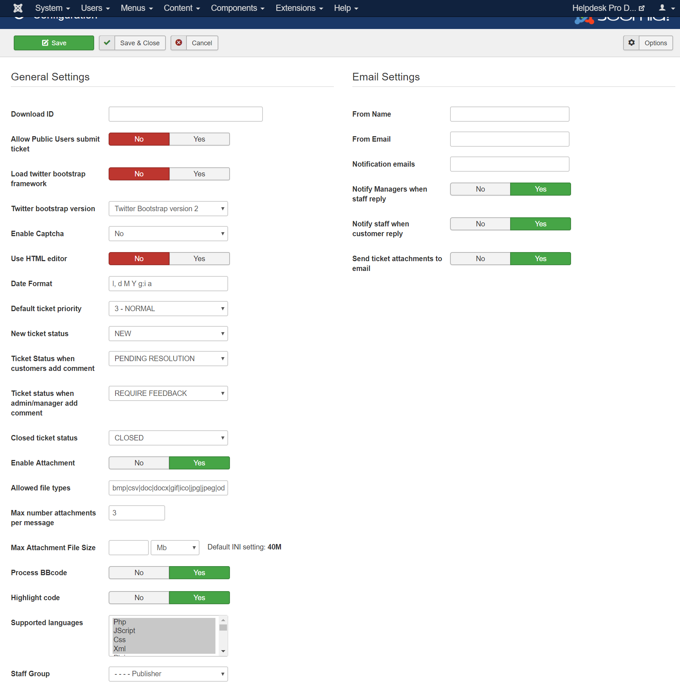

Helpdesk Pro creates a default configuration during installation. Go to **Helpdesk Pro → Configuration** to review the settings and adjust them for your site. If a setting has help text, hover over its label to read it.

## General Settings

- **Css Framework** sets the CSS framework Helpdesk Pro uses for its frontend layouts. The default is **Twitter Bootstrap Version 5**. Choose **UIKIT3** if your template uses UIkit 3.
- **Load Twitter Bootstrap** loads Joomla's Bootstrap stylesheet when the CSS framework is set to Bootstrap 5. Set it to **No** if your template already loads Bootstrap CSS, or **Yes** to have Helpdesk Pro load it.
- **Enable Captcha** helps prevent spam on ticket forms. Choose **Yes** to require CAPTCHA for everyone or **For Public Users Only** to require it only for visitors who are signed out. Enable and configure a CAPTCHA plugin in Joomla and select it as **Default Captcha** in **System → Global Configuration**.
- **Use HTML editor** displays the Joomla editor for ticket descriptions and replies when set to **Yes**. By default, Helpdesk Pro uses a plain text area.
- **Enable Attachment** lets users attach files to tickets and replies when set to **Yes**. Review **Allowed File Types** to control which files users can upload.

## Email Settings

- **From Name** and **From Email** set the sender name and address for Helpdesk Pro email. Leave either setting blank to use the corresponding value in Joomla's Global Configuration.
- **Notification Emails** lists the addresses that receive new ticket and customer reply notifications for categories without managers. If you handle tickets yourself, enter the email address where you want to receive these notifications. Separate multiple addresses with commas, such as `support@example.com,helpdesk@example.com`.
- **Send Ticket Attachments To Email** includes files uploaded with a ticket or reply in the notification email when set to **Yes**.
