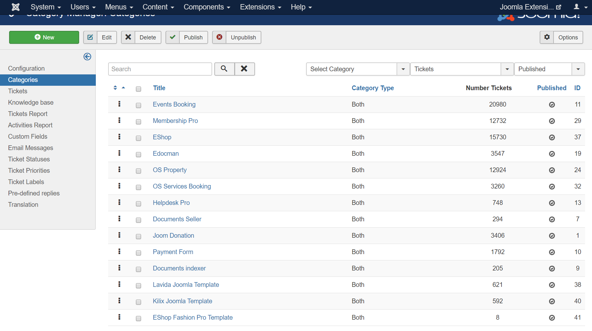

Categories organize support tickets by product, department, or topic. For a basic help desk, start with one published category such as **General Support**. You can add more categories and appoint managers as your support team grows.

## Add a Category

In the Joomla administrator area, go to **Helpdesk Pro → Categories** and click **New**. Fill in the **General** tab and click **Save & Close**. To change an existing category, click its title in the list.

| Setting | What to enter |
| --- | --- |
| **Title** | Enter a name customers will recognize on the ticket form, such as **Billing** or **Technical Support**. |
| **Alias** | Leave this blank to generate an alias from the title when you save. |
| **Parent** | Leave this set to **Select Category** for a top-level category, or choose an existing category to create a subcategory. |
| **Access Level** | Choose the Joomla viewing access level for this category. Use **Public** for general support or choose a restricted level for a specific audience. Guest ticket submission is controlled separately in [Configuration](/getting-started/configuration). |
| **Description** | Enter an optional summary. The knowledge base can show it on the article categories page. |
| **Category Type** | Choose **Tickets** for support requests, **Knowledge Base** for articles, or **Both** to use the category for tickets and articles. |
| **Published** | Set this to **Yes** to make the category available for use. |

On a multilingual Joomla site, use the **Translation** tab to enter the title, alias, and description for each additional language.

To publish help articles in a category, follow the [Knowledge Base guide](/knowledge-base).

## Assign Category Managers

If administrators handle all tickets, leave the **Managers** tab empty. Otherwise, open the **Managers** tab, use the Joomla user picker to select a manager, and add a row for each additional manager. Save the category when you finish. Set managers on each category they should manage, including any subcategories.

Managers can open and reply to tickets in their categories from the **Ticket List/ Manage Tickets** menu item on the site. Helpdesk Pro sends new ticket and customer reply notifications to the category managers. For categories without managers, Helpdesk Pro uses **Notification Emails** in [Configuration](/getting-started/configuration).

See [Set Up a Support Team](/setup/support-team) to test a manager's queue and configure staff assignment.

## Check the Submit Ticket Form

After setting up the [Submit Ticket menu item](/setup/menu-items#submit-ticket), open it on the site as a customer and confirm the category is available. If the category is missing, check these settings:

- **Published** is set to **Yes**.
- **Category Type** is set to **Tickets** or **Both**.
- The customer's Joomla account has the category's **Access Level**.
- If the menu item's **Category Ids** field is filled in, include the category's ID in that list. You can find the ID in the **Categories** list.

You can also assign [custom fields](/setup/custom-fields) to selected categories to collect different information for different support requests.
