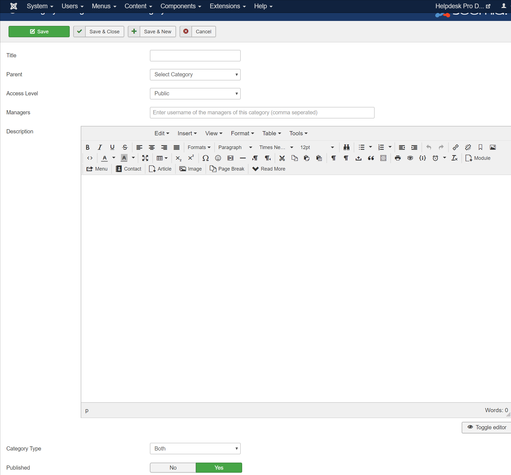

After perform basic configuration, the next step would be setup **Categories**. When customers submit suppor ticket, they must choose a category which they want to request for support (each category could be a department on your company, a product or anything..., it really depends on your own requirement). 

Access to Helpdesk Pro -> Categories to go to categories management page.

## Add new category
Press **New** button in the toolbar to create new category. A form will be displayed to allow you to enter information of the category:

<table class="table table-stripped table-bordered table-considered">
<thead>
<tr><th width="15%">Property</th><th>Description</th></tr>
</thead>
<tbody>
<tr>
<td><strong>Title</strong></td>
<td>Title of the category. It will be displayed in categories dropdown when customers submit ticket.</td>
</tr>
<tr>
<td><strong>Parent</strong></td>
<td>Select parent of this category. Set it to <strong>Select Category</strong> and it will become top level category.</td>
</tr>
<tr>
<td><strong> Access Level</strong></td>
<td>Choose the access level for this category (usually Public). By choosing an access level, only users has this access level can submit ticket to thecategory.</td>
</tr>    
<tr>
<td><strong>Managers</strong></td>
<td>If you want to give some users permission to manage tickets submitted to this category, enter username of the manager(s) into this parameter. If a category has multiple managers, simply enter their username into this field (comma separatd, for example admin,tuanpn).</td>
</tr>
<tr>
<td><strong>Description</strong></td>
<td>Description of the category. As of right now, category is not displayed anywhere, it will just be used for managing purpose only, leave this empty if you want.</td>
</tr>
<tr>
<td><strong>Category Type</strong></td>
<td>Tickets, Knowledge base or Both. If set to Tickets, the category will be displayed on submit ticket form. If set to Knowledge base, it will be displayed on a create knowledge base article form.</td>
</tr>
</tbody>
</table>