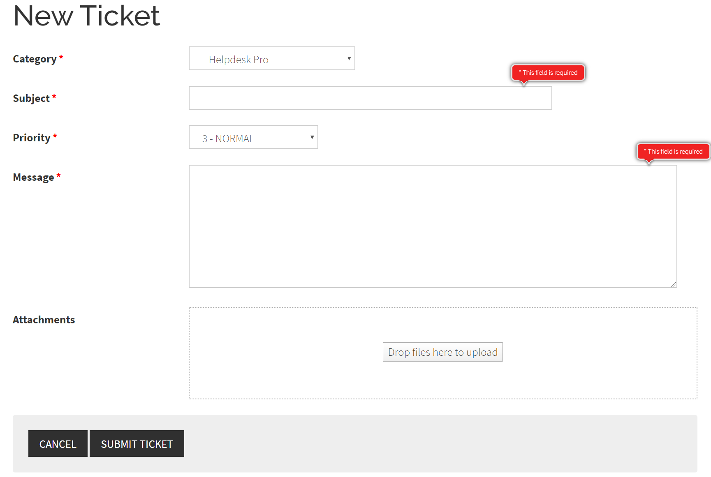
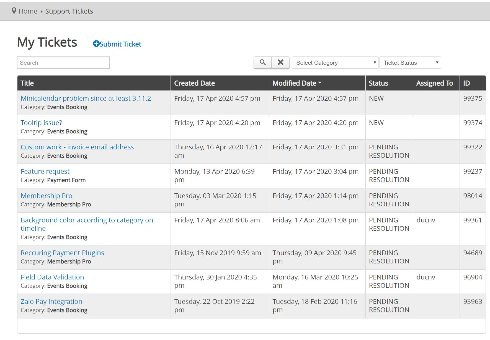

Use Joomla menu items to give customers a place to submit tickets, follow up on requests, or find answers in your knowledge base. For a basic help desk, start with **Ticket List/ Manage Tickets**, which includes a **Submit Ticket** button. Add a separate **Submit Ticket** menu item if you want a direct link to the form or plan to accept tickets from guests.

| Menu item type | Use it when you want to |
| --- | --- |
| [Submit Ticket](#submit-ticket) | Link directly to the new ticket form. |
| [Ticket List/ Manage Tickets](#ticket-list-manage-tickets) | Let signed-in users find, open, and reply to tickets they can access. |
| [Knowledge Base Categories](#knowledge-base-categories) | Let visitors browse help articles by topic. |
| [Knowledge Base Articles](#knowledge-base-articles) | Show a searchable list of help articles. |
| [Article Detail](#article-detail) | Link directly to one help article. |

## Create a Menu Item

1. In the Joomla administrator area, go to **Menus**, open the site menu where you want the link, and click **New**.
2. Enter a **Title** for the link, such as **Support Tickets** or **Help Center**.
3. Next to **Menu Item Type**, click **Select**, expand **Helpdesk Pro**, and choose one of the types below.
4. Configure the settings for that type, choose an **Access** level for the intended audience, set **Status** to **Published**, and click **Save & Close**.

## Submit Ticket

Use this type for a **Contact Support** link or a form for a specific department, such as **Billing Support**. Before you publish it, set up at least one published [ticket category](/setup/categories) that the intended users can access.

| Setting in the Options tab | How to use it |
| --- | --- |
| **Default Category** | Preselect a category when the form opens. If you also set **Category Ids**, choose a default from that list. |
| **Category Ids** | Enter comma-separated category IDs, such as `3,7`, to limit the choices on this form. Find the IDs in **Helpdesk Pro → Categories**. Leave this blank to show all published ticket categories the visitor can access. If only one category is available, the form selects it automatically and hides the category selector. |
| **Intro Text** | Add instructions above the form, such as what information customers should include in their request. |

To accept guest tickets, set the menu item's **Access** to **Public**, make at least one ticket category accessible to guests, and enable **Allow Public Users Submit Ticket** in [Helpdesk Pro Configuration](/getting-started/configuration). For a form intended for signed-in users, use **Registered** or another access level that includes those users.

## Ticket List/ Manage Tickets

Use this type for a **Support Tickets** or **My Tickets** link. The page requires users to sign in. Set **Access** to **Registered** if customers and the support team should share the menu item. Each user sees the tickets available to their [Helpdesk Pro role](/getting-started/user-roles).

| Role | Tickets shown |
| --- | --- |
| Customer | Their own tickets. |
| Administrator | Tickets from all categories. |
| Category manager | Tickets in the categories they manage, plus tickets they submitted or that were assigned to them. |
| Staff member | Tickets assigned to them. |

Users can search and filter the list, open a ticket by clicking its subject, or start a new request with **Submit Ticket**.

| Setting in the Options tab | How to use it |
| --- | --- |
| **Show User** | Show who submitted each ticket. Helpdesk Pro hides this column in the customer view. |
| **Show Created Date**, **Show Modified Date** | Show when each ticket was opened or last updated. |
| **Show Status**, **Show Priority** | Show each column when at least one status or priority of the corresponding type is published. |
| **Show Staff** | Show the assigned staff member when the [Assign Ticket plugin](/plugins/assign-ticket) is enabled. |
| **Show Category** | Show the category beneath each ticket subject. |
| **Enable Export Tickets** | Show a CSV export button for administrators and category managers when the list contains tickets. The option defaults to **No**. |
| **Intro Text** | Add a message above the ticket list. |

## Knowledge Base Categories

Use this type as the landing page for a knowledge base organized by topic. It shows published categories that the visitor can access and that contain at least one published article. Each category shows its article count, its description if provided, and links to up to 10 articles. Visitors can click the category title to see its full article list.

Create [categories](/setup/categories) with **Category Type** set to **Knowledge Base** or **Both**, then add and publish articles under **Helpdesk Pro → Knowledge Base**. In the menu item's **Options** tab, set **Number Columns** to the number of categories to display per row. The default is **2**.

## Knowledge Base Articles

Use this type when visitors should go straight to a searchable article list. On the **Details** tab, choose a **Category** to open the list for that topic, or leave it unset to show published articles from all published categories the visitor can access. The page includes a search field and category filter.

## Article Detail

Use this type to feature one article, such as a getting-started guide or an answer to a common support question. On the **Details** tab, use **Select Article** to choose a published article from **Helpdesk Pro → Knowledge Base**.

## Check Your Menu Items

Sign in to the site as a customer, submit a test ticket, and confirm it appears in the ticket list. If you accept guest tickets, also open the form while signed out and check that the intended categories are available. Open any knowledge base links as an intended reader to verify the categories and articles they should see.
