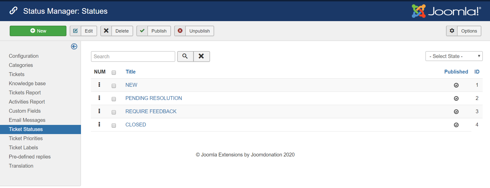

Go to **Helpdesk Pro** -> **Ticket Statuses** to manage Ticket Statuses in the system. **Helpdesk Pro** has 4 ticket statuses by default and it should be enough for normal usage:

- **NEW**: That's status of the ticket when customer support the ticket.
- **REQUIRE FEEDBACK**: That's the status of ticket after Admin/Manager/Staff added comment to reply to the ticket.
- **PENDING RESOLUTION**: That's the status of ticket after customers added comment to reply to the ticket.
- **CLOSED**: That's the status of ticket when the support request completed. The ticket could be closed by **Customer** or by **Admin/Manager**.

In case you want to have more ticket statuses, you can press New button in the toolbar to add more statuses to meet your need.

