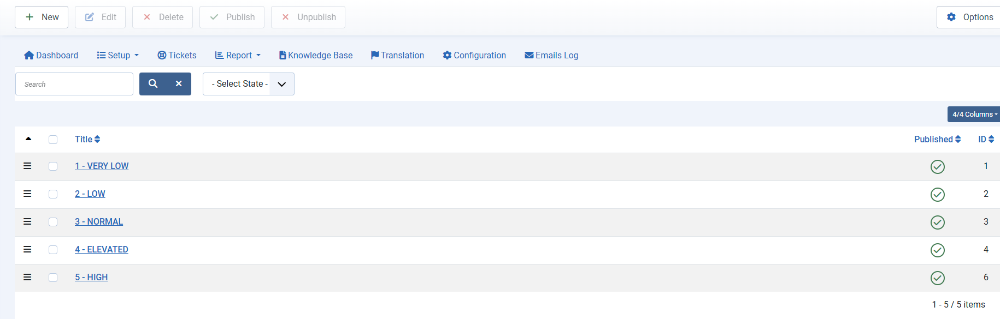

When customers submit support ticket, they can choose a priority for the ticket (so that you will know how urgent the support request is). He can also change the priority of the ticket if needed (for example, when the problem is more urgent, he can increase the priority).

Go to **Helpdesk Pro** -> **Ticket Priorities** to manage Ticket Priorities in the system. You can publish, unpublish, delete ticket priorities or create a new ticket priority from there if needed.

If you don't want customers has to choose ticket priority while submitting support ticket (to simplify the process), you can unpublish all the ticket priorities in the system

