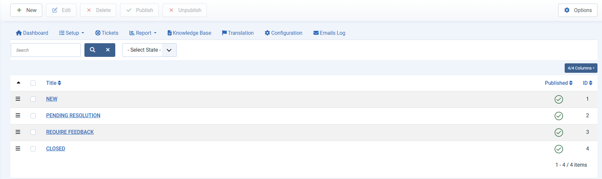

Ticket statuses help you see which requests need a response from your support team and which are waiting for the customer. In the Joomla administrator area, go to **Helpdesk Pro → Ticket Statuses** to view or edit the available statuses.

## Default Ticket Workflow

| What happens | Default status | Configuration setting |
| --- | --- | --- |
| A customer submits a ticket. | **New** | **New Ticket Status** |
| An administrator, manager, or staff member posts a reply visible to the customer. | **Require Feedback** | **Ticket Status When Admin/Manager Add Comment** |
| The customer replies. | **Pending Resolution**. A ticket still in **New** keeps that status. | **Ticket Status When Customers Add Comment** |
| The ticket is closed. | **Closed** | **Closed Ticket Status** |

To change these defaults, go to [Helpdesk Pro → Configuration → General Settings](/getting-started/configuration#ticket-workflow-and-default-filters). For replies posted on the ticket page, select **Don't change status** in either reply setting to keep the current status. Internal comments leave the status unchanged.

## Change or Close a Ticket

Open a ticket and use **Change Ticket Status** to select a status manually. This action requires the **Change Ticket Status** permission and access to the ticket. To reopen a closed ticket, use the same control to select an open status.

Use **Add Comment and Close Ticket** to post a final reply and close the ticket in one step. If **Enable Rating** is on, the customer can select **Rate & Close Ticket** to submit a rating and close the ticket. The [Auto Close Tickets scheduled task](/scheduled-tasks/auto-close-tickets) can close inactive tickets automatically. These actions use the configured **Closed Ticket Status**. Customers can still view a closed ticket, and the ticket page hides the reply form from them.

## Add a Custom Status

1. Go to **Helpdesk Pro → Ticket Statuses** and click **New**.
2. Enter a **Title**, such as **In Progress**. Optionally set **Ticket Background Color** to highlight rows with this status in the ticket list.
3. Set **Published** to **Yes** and save. The status is now available in **Change Ticket Status** and in the status dropdowns in **Configuration**.
4. If this status should be assigned automatically, select it in the relevant workflow setting under **Helpdesk Pro → Configuration → General Settings** and save.

The default ticket list filter for administrators, managers, and staff shows **New** and **Pending Resolution**. To include a custom status in the default view, add it to **Manage Tickets Default Status Filters** in **General Settings**. To check tickets in any published status, select that status or **All** in the ticket status filter.

