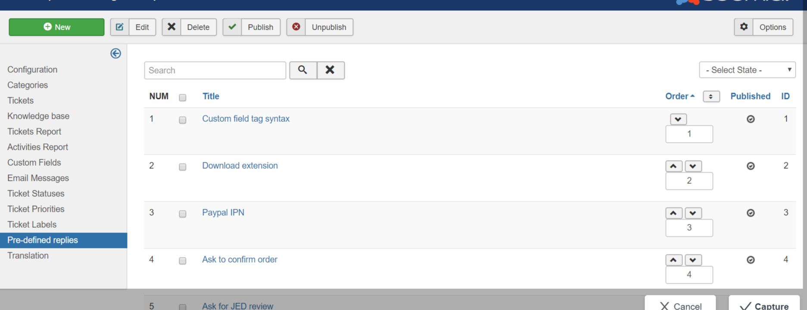
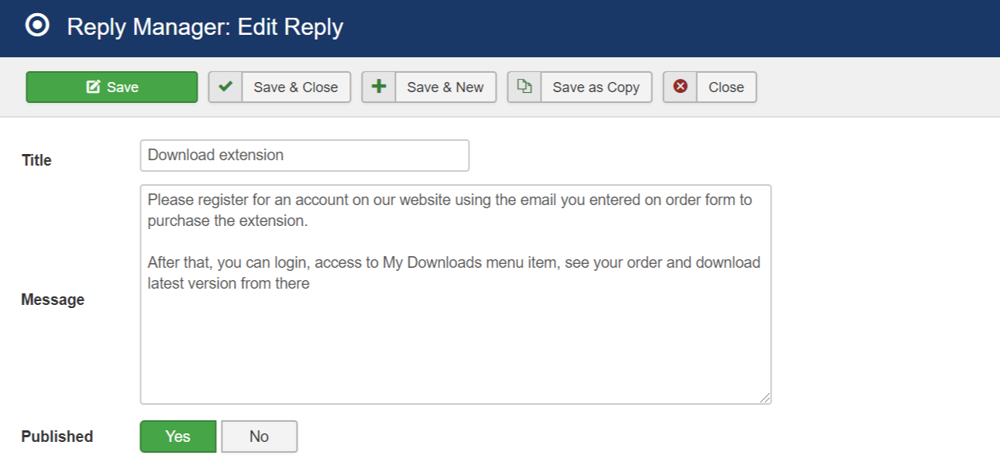
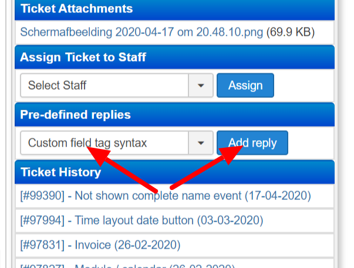

During support process, you will realize that there are some response/reply message which you have to use again and again to reply to support request from different customers. To avoid having to type these messages again and again, you can use **Pre-defined Replies** feature in the extension

1. Go to Helpdesk Pro -> Predefined Replies to add these pre-defined replies. Each pre-defined reply contain a Subject and a Message
2. Go to Extensions -> Plugins, enable **Helpdesk Pro - Pre-reply messages** plugin.
3. When you reply to a suppor ticket, you can select a pre-defined reply and press **Add** button to add that pre-defined reply to the comment/message you are replying to customer.

