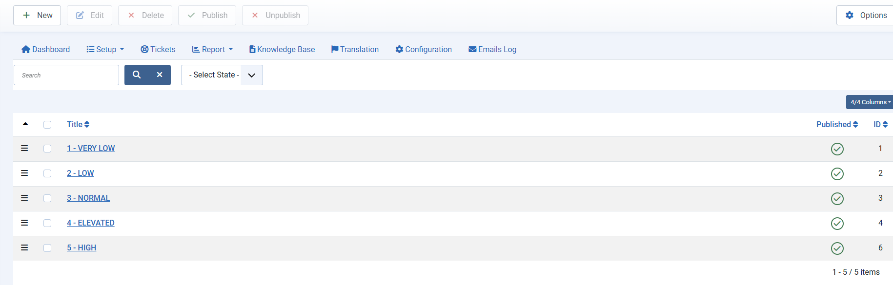

Priorities show how urgent a request is. Customers can choose a priority when they submit a ticket and, if the **Change Ticket Priority** control is available to them, raise it later. Your support team can also change it from the ticket page and filter the ticket list by priority.

A new installation includes five published priorities, from **1 - Very Low** to **5 - High**. Many sites can use them as they are.

## Manage Priorities

1. In the Joomla administrator area, go to **Helpdesk Pro → Ticket Priorities**.
2. Click **New** to add a priority, or click a title to edit it. Enter a **Title**, set **Published** to **Yes**, and save.
3. To change the order shown in lists, sort by ordering and drag the rows into place.
4. Unpublish a priority to remove it from the forms without deleting it. On a multilingual site, use the **Translation** tab to translate the title.

## Choose the Default Priority

Select **Default Ticket Priority** in [Configuration → General Settings](/getting-started/configuration#ticket-workflow-and-default-filters). It is preselected on the new ticket form. The default is **3 - Normal**.

## Hide Priorities from Customers

To simplify the submission form, unpublish all priorities. Customers are then no longer asked to choose one, and the priority column and filter are hidden from ticket lists.
