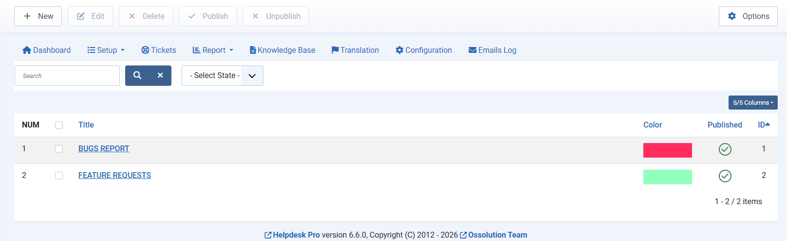

Labels are an optional way for your support team to tag tickets, for example **Bug**, **Refund**, or **Waiting for developer**. Unlike categories, which the customer picks, labels are applied by the support team and let you filter the ticket list.

## Create a Label

1. In the Joomla administrator area, go to **Helpdesk Pro → Ticket Labels** and click **New**.
2. Enter a **Title** and, optionally, a **Color**.
3. Set **Published** to **Yes** and save.

## Apply and Remove a Label

1. Open a ticket as an administrator, category manager, or staff member. Customers do not see this control.
2. Choose **Apply Label** above the conversation and select a label.
3. To remove the label, choose **NO LABEL**.

A ticket has one label at a time. Choosing another label replaces the first.

## Find Labeled Tickets

Use the label filter in the [ticket list](/manage-tickets#find-and-open-a-ticket) to show only tickets with a chosen label.
