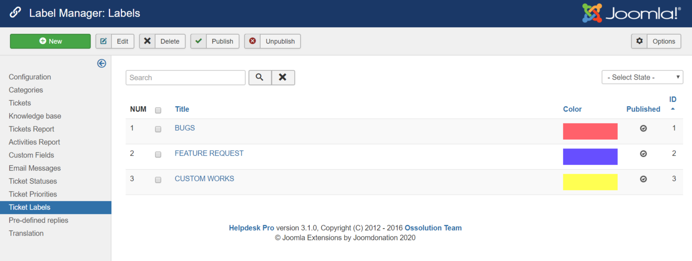

If it's needed, you can create **Ticket Labels** and add Label for your ticket. Use label gives you another way to categorize and filter your tickets based on Label if needed.

1. Go to Helpdesk Pro -> Ticket Labels to create and manage Ticket Labels
2. When you view a ticket (from administrator area of your site), you can use Apply Label function to assign label to your ticket
3. On Tickets Manage screen, you can filter tickets which has a Label assigned to

