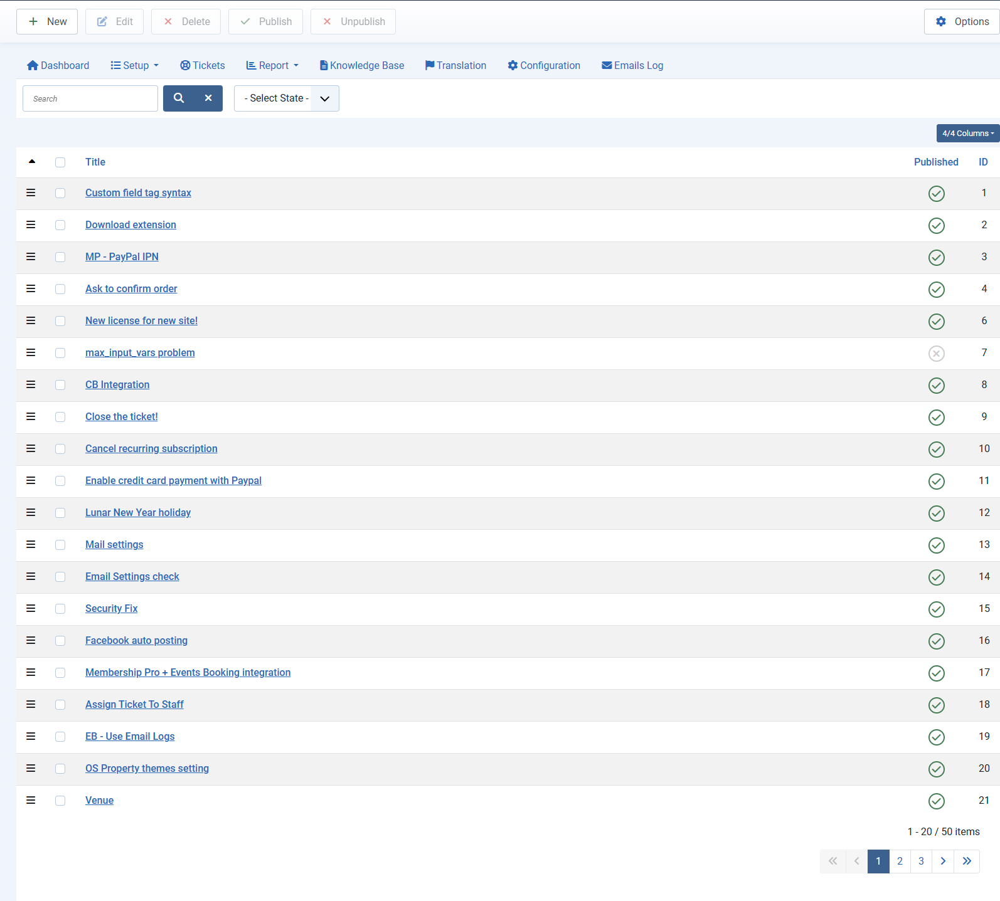
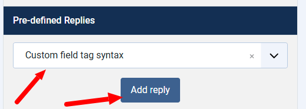

Save answers to common support questions as pre-defined replies. For example, you can save instructions for downloading an invoice or ask customers for the information you need to investigate a problem.

## Create a Pre-defined Reply

1. In the Joomla administrator area, go to **Helpdesk Pro → Pre-defined Replies** and click **New**.
2. Under **Category**, select the ticket category where the reply should be available. For example, choose **Billing** for invoice instructions. A category-specific reply appears only on tickets in the selected category.
3. Enter a **Title** that your support team can recognize in the dropdown, such as **Download an invoice**.
4. Enter the reusable text in **Message**. This is the text that will be inserted into the ticket comment.
5. Set **Published** to **Yes** and click **Save & Close**.

The **All** option is intended for replies shared across categories. If saving with **All** fails or the reply is missing from the ticket, select the ticket's specific category and save again.

## Manage Saved Replies

Click a reply's title to edit it. Unpublish a reply to remove it from the ticket dropdown while keeping it available for future use. To change the order in the dropdown, sort the list by **Ordering** and drag the replies into the desired order.

## Use a Saved Reply

Replies are inserted by the **Helpdesk Pro - Pre-reply messages** plugin. It adds a **Pre-defined replies** dropdown to the ticket sidebar for administrators, category managers, and staff.

1. In **System → Manage → Plugins**, search for **Helpdesk Pro - Pre-reply messages** and enable it.
2. Open a ticket in the reply's category and click **Add comment**.
3. Place the cursor where the saved text should appear, select the reply by title in **Pre-defined replies**, and click **Add reply**.
4. Edit the inserted message for the customer, then click **Add Comment** to post it.

If the dropdown is missing, check that the plugin is enabled, you are viewing the ticket as an administrator, category manager, or staff member, and at least one published reply applies to the ticket's category.
