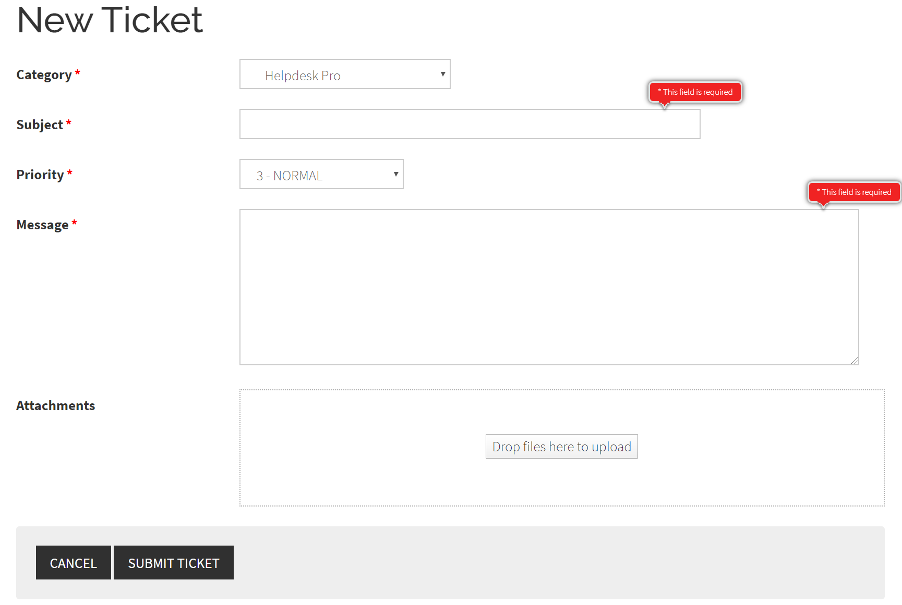

## Submit Ticket
Whenever need support, customers need support, they will go to your site to submit ticket. There are two ways for customers to submit ticket:

- Access to [**Submit Ticket**](/setup/menu-items#submit-ticket) menu item (if you create) to submit ticket. 
- From [**Support Tickets**](/setup/menu-items#ticket-list-manage-tickets) menu item, click on **Submit Ticket** link to  submit ticket. 

## Manage Tickets
Customers, after login, can access to [**Support Tickets**](/setup/menu-items#ticket-list-manage-tickets) menu item to see their list of supported tickets and check ticket status. They can also click on a support ticket to see the ticket details (response from admin/manager/staff who works on the ticket).

## Reply To Ticket
After receiving response for support request, customers might want to reply to that response to provide more information... until the support request completed. To do that, he can access to ticket details page (from [**Support Tickets**](/setup/menu-items#ticket-list-manage-tickets) menu item or by clicking on the link to ticket details page in the notification email)

On ticket details page, he can click on **Add Comment** button to add response to a ticket. When customers reply to a ticket, they will need to add a message (maybe to provide additional information) and upload (optional) attachments.

## Rate And Close Ticket
When support request completed, Customers can Rate and Close the ticket.