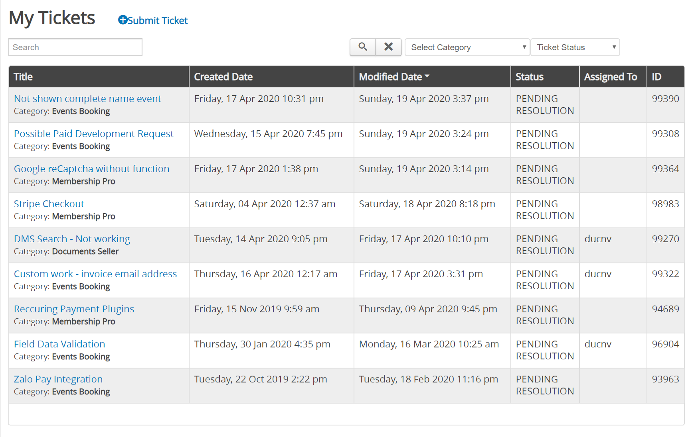
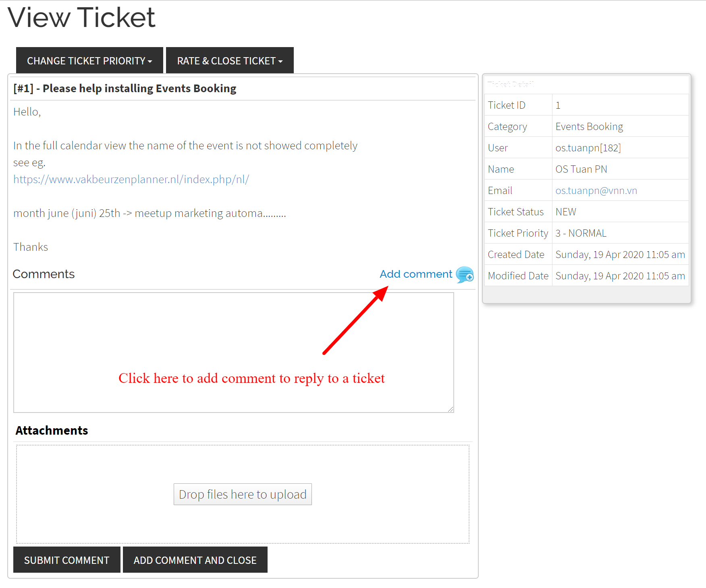
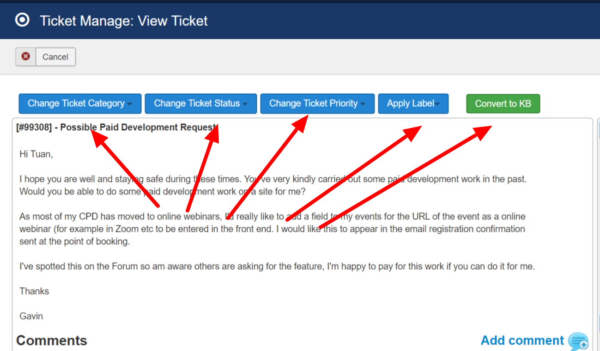

## Manage Tickets
To answer support requests from customers, Admins/Managers/Staffs can access to [**Support Tickets**](/setup/menu-items#ticket-list-manage-tickets) menu item. From that page, alll tickets which they can/need to work on is displayed. They can click on a ticket to see the support request details, all comments added to the ticket and add comment to reply to a support request.

- Admin will see support tickets from all categories.
- Manager will see support tickets form the categories which he is setup as Manager.
- Staff will see support tickets which he is assigned to (By Admin or Manager)

Unlike Managers/Staffs, Administrators can also manage tickets from administrator area of the site by access to **Helpdesk Pro** -> **Tickets**

## Reply To Ticket
Like customers, to reply to a ticket, Admin/Manage/Staff will just need to access to ticket details page, press Add Comment button to add a comment to ticket. Together with adding comment, he can also upload attachments for the response if needed.

## Assing Ticket To Staff
If configured, from ticket details page, Admin/Manage can also assign support ticket to the staff which has the skill to address the support request. When a staff is assigned, he will receive notification email from the system about this ticket assignment and work on the support request to get it sorted. See [Assign Ticket Plugin](/plugins/assign-ticket) for details instructions to setup and use this feature.

## Update Ticket
On ticket details page, Administrator/Manage can also update the ticket, including:

- Change Category
- Change Ticket Status
- Change Ticket Priority
- Apply Label To Ticket
- Convert the ticket to a knowledge base article

