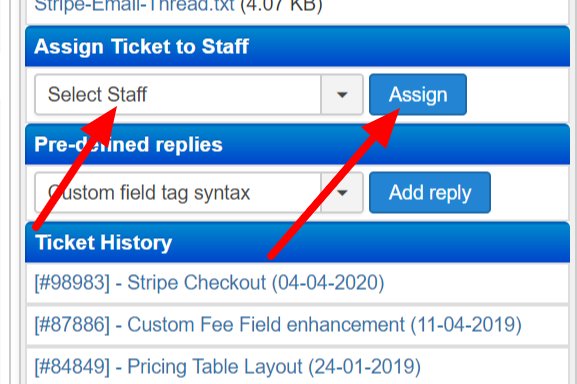

This plugin allow admin/manager assign support ticket to a support staff. To use this plugin:

1. Go to Users -> Groups, add a new user group called **Staff**. This should be child group of **Registered** user group
2. Assign all staff users into that **Staff** user group
3. Go to Extensions -> Plugins, find and enable the plugin **Helpdesk Pro - Assign Ticket**
4. Now when Admin/Manager access to a ticket, they will see a section which allow assigning a support ticket to a staff (see the screenshot below)

