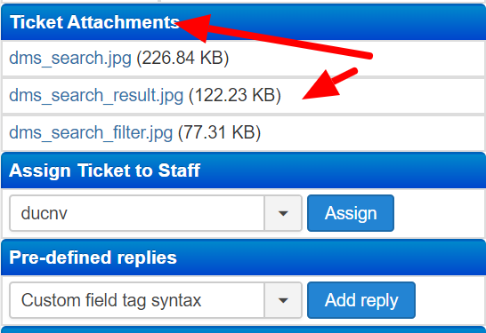

This plugin display all attachments added to a support ticket to allow (customers/staff/manager/staff) to download any attachment file quickly

To use this plugin, just go to **Extensions** -> **Plugins**, find and enable **Helpdesk Pro - Ticket Attachments** plugin.

