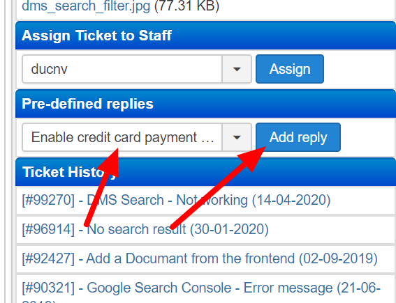

The **Helpdesk Pro - Pre-reply messages** plugin adds a **Pre-defined replies** dropdown to the ticket details page. Administrators, category managers, and staff can use it on tickets they can access, in the administrator area or on the site according to their role.

## Enable the Plugin

1. In the Joomla administrator area, go to **System → Manage → Plugins**, search for **Helpdesk Pro - Pre-reply messages**, and enable it.
2. [Create and publish a pre-defined reply](/setup/pre-defined-replies) for the ticket category you want to use it in.

## Insert a Reply into a Comment

1. Open a ticket and click **Add comment** to open the comment form.
2. Place the cursor where you want the saved text to appear. In **Pre-defined replies**, select the reply by title and click **Add reply** to insert its message at the cursor.
3. Review and edit the comment, then click **Add Comment** to post it.

If the dropdown is missing, check that the plugin is enabled, you are viewing the ticket as an administrator, manager, or staff member, and at least one published reply applies to the ticket's category.
