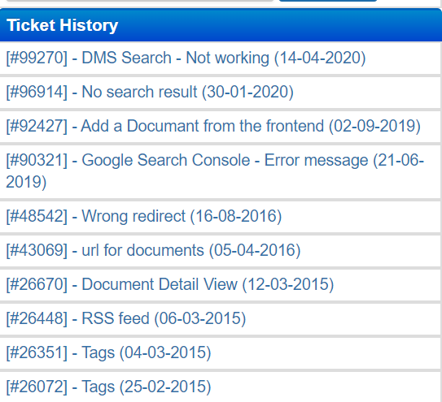

This plugin allows viewing tickets history of a customer on Ticket Details Page. That allows you to quick access to his other tickets if needed

To use that plugin:

1. Go to Extensions -> Plugins Manager, find and publish the plugin **Helpdesk Pro - Tickethistory**
2. Now when Admin/Manage/Staff works on a support ticket, he will see list of other support tickets submitted by same customer.

