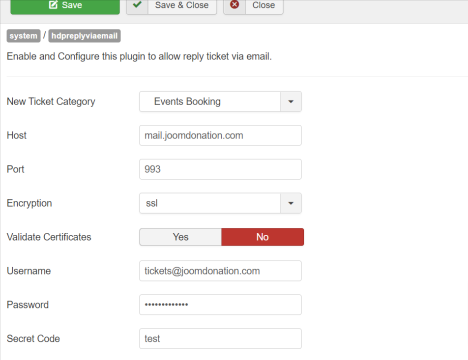
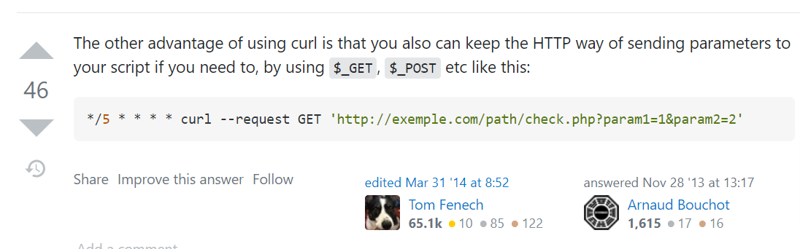

>>> This feature requires PHP 7.2.0+ to work. So if you are using older version of PHP, please update to PHP 7.2.0+ first before enabling this feature.

This is a nice feature available from Helpdesk Pro version 4.2.0. It allows:

- Create support tickets when someone sends email to certain email address (for example contact@domain.com, support@domain.com)
- Allow adding comments to support tickets by replying via email. That allows admin and customers to reply to a support tickets much easier. Instead of having to login to the website, access to support ticket and add comment to that ticket, you can just press Reply button in your mail client, write the message, add attachments if needed to reply.

In order to use this feature, please:

1. Go to Helpdesk Pro -> Configuration, add the email you want into **Reply To Email**. This is the email will receive email when admin/customers reply to ticket from his mail client. **Helpesk Pro** will then this and process all emails from that mailbox to create new ticket or add comment to an existing tickets
2. Go to Extensions -> Plugins, find the plugin **System - Helpdeskpro Reply Via Email**, click on it to edit and enter neccessary paramerers like in the screenshot below:

Below are the meaning of some parameters (you can read [https://www.php.net/manual/en/function.imap-open.php](https://www.php.net/manual/en/function.imap-open.php) to understand the meaning of some parameters here)

1. **Encryption**
- **ssl**:Use the Secure Socket Layer to encrypt the session
- **tls**:Force use of start-TLS to encrypt the session, and reject connection to servers that do not support it
- **notls**:Do not do start-TLS to encrypt the session, even with servers that support it
2. **Validate Certificates:
- **Yes**: validate certificates from TLS/SSL server (this is the default behavior)
- **No**: do not validate certificates from TLS/SSL server, needed if server uses self-signed certificates

3. **Setup Cron Job**
You should setup cron job to trigger **System - Helpdeskpro Reply Via Email** plugin to fetch new emails and to create new ticket or add comments to existing ticket. Follow instructions at https://stackoverflow.com/questions/11375260/cron-command-to-run-url-address-every-5-minutes to setup a cron job to make a request to the URL: https://domain.com/index.php?secret_code=TEST every 5 or 10 minutes (or the time you want) using CURL

- Replace https://domain.com/ with URL of your site
- Replace TEST with with the text/string you entered into **Secret Code** parameter of the **System - Helpdeskpro Reply Via Email** plugin

You can ask for help from your hosting provider to setup it is needed. Sample cron job:

*/5 * * * * curl --request GET 'https://domain.com/index.php?secret_code=TEST'

Please note that for testing, you can also access to that PHP file directly from your web browser by entering https://domain.com/index.php?secret_code=TEST

See the instrunctions in this screenshot. That's the right solution to use

4. Enable **System - Helpdeskpro Reply Via Email** plugin

>>> In case the parameters you entered into System - Helpdeskpro Reply Via Email plugin, and the system could not connect to the mailbox to get emails to process, the error message will be logged plugins/system/hdpreplyviaemail/logs.txt. You can check that folder to see if there is any error in case something not working as expected.

