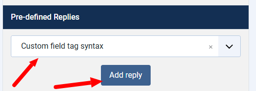

**Helpdesk Pro - Pre-reply messages** adds a **Pre-defined replies** dropdown to the ticket details sidebar. Administrators, category managers, and staff can use it on tickets they can access. Use it for answers and requests your team sends regularly, such as asking for an order number or explaining how to download an invoice.

## Enable the Plugin

1. In the Joomla administrator area, go to **System → Manage → Plugins**, search for **Helpdesk Pro - Pre-reply messages**, and enable it.
2. [Create and publish a pre-defined reply](/setup/pre-defined-replies) for the ticket category where your team needs it.

## Insert a Reply into a Comment

1. Open a ticket and click **Add comment**.
2. Place the cursor where you want the saved text to appear. In **Pre-defined replies**, select the reply by title and click **Add reply** to insert the message into the comment.
3. Edit the message for the customer and click **Add Comment** to post it.

If the dropdown is missing, check that the plugin is enabled, you are viewing the ticket as an administrator, category manager, or staff member, and at least one published reply applies to the ticket’s category.
