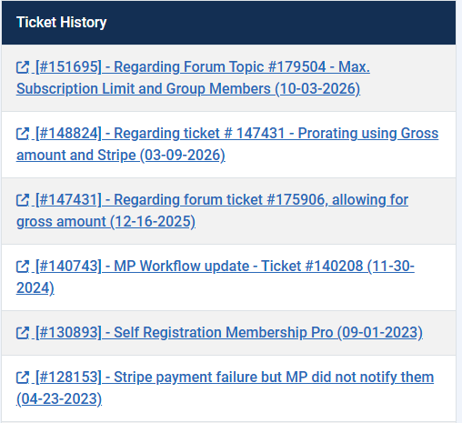

**Helpdesk Pro - Ticket History** shows recent tickets associated with the current ticket’s customer. Use it to look up an earlier conversation or spot repeat requests. In the **Ticket History** sidebar, click a ticket’s subject to open it in a new tab. The list can include the current ticket.

The sidebar is visible to signed-in viewers on the site and in the administrator area. It matches tickets by Joomla user account or email address and can show subjects outside the viewer’s ticket permissions. Guest tickets with no linked Joomla account can also be grouped together. Keep this plugin disabled if those subjects need to stay private.

## Configure the Plugin

1. In the Joomla administrator area, go to **System → Manage → Plugins** and open **Helpdesk Pro - Ticket History**.
2. Set **Limit** to the maximum number of tickets to list. The default is **10**, with the newest ticket IDs first.
3. Set **Date Format** for the date next to each subject. The default, `m-d-Y`, displays a date such as `11-16-2026`. Use `d-m-Y` for `16-11-2026`.
4. Enable and save the plugin. Open a ticket for a customer with several requests and check the list.

